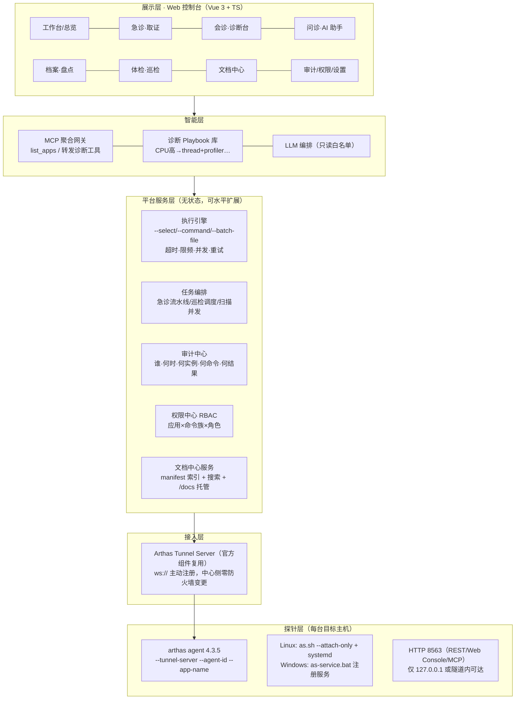

# 扁鹊 · BianQue 运维诊断平台 — 产品设计方案 V1.0

| 项 | 内容 |
|---|---|
| 文档依据 | 《Arthas-4.3.5-运维产品调研评估报告》（`docs/research/`）、`arthas-packaging-4.3.5-doc.zip` 官方文档包（解包于 `docs/arthas-docs/4.3.5/`，已核验） |
| 配套文档 | 技术选型 V1.0 与开发计划 V1.0 见 `plan/`；项目导览见根目录 `README.md` |
| 设计范围 | 平台总体设计、易用性与界面设计、官方文档集成设计、安全与可靠性设计、交付路线图 |
| 配套交付物 | ① 本文档；② `design/arthas-docs-manifest.json`（文档中心构建清单，78 页双语）；③ 可交互界面原型（见附录 C） |
| 版本 / 日期 | V1.0 / 2026-10-27 |
| 品牌 | 扁鹊 · BianQue（承袭调研报告第四章：平台主品牌 + 四诊法子品牌体系，CLI 缩写 `bq`） |

---

## 1. 产品概述

### 1.1 一句话定位

> **把"SSH 登录 → java -jar arthas-boot.jar → 敲命令"变成"浏览器选应用 → 选场景 → 看结论"，并用安全壳把 Arthas 等价于"进程内任意代码执行"的能力管起来。**

扁鹊不重新发明诊断能力，而是基于 `arthas-packaging-4.3.5` 的"探针 + 引擎 + HTTP API + 内置 MCP Server + tunnel 纳管"原料，在调研报告锁定的四个产品化维度上做壳：**易用性、自动化、安全管控、多机规模化**。

### 1.2 设计三原则（本方案的三大支柱）

| 原则 | 含义 | 落点 |
|---|---|---|
| **易用（零门槛）** | 不要求用户记忆 Arthas 命令语法；常用场景一键化、专家场景表单化 | 第 4 章 界面设计 + 第 5 章 文档集成 |
| **可靠安全（红线内建）** | 平台默认安全：强制认证、命令白名单、全量审计、会话自动回收 | 第 6 章 安全与可靠性 |
| **知识内建（文档即功能）** | `arthas-packaging-4.3.5-doc.zip` 不是外挂链接，而是被索引、可搜索、随命令上下文出现的内建知识层 | 第 5 章 |

### 1.3 用户角色与核心场景

| 角色 | 画像 | 核心场景 | 首选入口 |
|---|---|---|---|
| 值班 SRE / 后端 | 收到告警要 5 分钟内给出初步结论 | 告警 → 自动取证 → 看现场报告 | 扁鹊·急诊 |
| 一线研发 | 不熟 Arthas 语法，被生产问题追问 | 选模板/填表单 → 跑 trace/watch → 看可视化结果 | 扁鹊·会诊诊断台 |
| 全体研发 | 会说话就会排障 | 自然语言描述 → AI 按 playbook 采集 → 结论 + 证据链 | 扁鹊·问诊（MCP） |
| 安全 / 运维 | 漏洞爆发要分钟级给受影响实例名单 | 批量 `sc -d` 扫描 → 命中清单 | 扁鹊·档案 |
| 平台管理员 | 管权限、审计、agent 生命周期 | 权限矩阵、审计检索、agent 升级 | 管理中心 |

---

## 2. 产品范围与版本规划

采纳报告评分矩阵结论（P1≈P2 > P5 > P6 > P4 > P3 > P7 > P8），按"**平台壳先行、能力模块渐进挂载**"组织：

| 平台版本 | 挂载模块（子品牌） | 对应报告 | 说明 |
|---|---|---|---|
| **V1.0（MVP）** | 平台壳 + 纳管 + 执行引擎；扁鹊·急诊（P1）、扁鹊·体检（P6）、扁鹊·档案（P5） | 报告第 5、8 章 | 低成本、见效快，共用执行底座 |
| **V1.5** | 扁鹊·问诊个人版（内置 MCP 接入指引）→ 平台版 MCP 网关 | 报告 P2 | 抓住 4.3.5 内置 MCP Server 的窗口期红利 |
| **V2.0** | 扁鹊·会诊 DiagHub 完整版（Web 诊断台、模板库、会话录制回放、RBAC 完全体） | 报告 P3 | tunnel 底座成型后建设 |
| **V2.5** | 扁鹊·听诊 FlameLens（持续剖析 + 发布前后 diff） | 报告 P4 | 依赖会诊的会话与存储层 |
| **V3.0（单独立项评估）** | 扁鹊·手术 HotPatch（强管控热修复）、扁鹊·监护 BlackBox（试点） | 报告 P7 / P8 | 高风险高成本，谨慎投入 |

本设计方案覆盖 V1.0–V2.0 的完整产品与界面设计（原型即为 V2.0 目标形态的演示），安全与文档底座自 V1.0 起生效。

---

## 3. 总体架构

### 3.1 分层架构



### 3.2 与发行包能力映射（产品不重造轮子）

| 平台能力 | 直接复用的发行包能力 | 平台自建部分 |
|---|---|---|
| 多机纳管 | `--tunnel-server --agent-id --app-name`、`as-service.bat` | 应用/实例台账、agent 版本管理与健康心跳 |
| 自动化诊断 | `as.sh --command / --batch-file / --select / --execution-timeout / --attach-only` | 执行引擎（结构化解析、限频、错峰、重试） |
| Web 诊断 | HTTP API 8563、Web Console、tunnel | 表单化命令、模板库、结果可视化、录制回放 |
| AI 问诊 | 内置 MCP Server（`http://127.0.0.1:8563/mcp`，Streamable HTTP，29 工具，Bearer Token） | MCP 聚合网关、Playbook、审计与人工确认 |
| 私有命令 | `commandLocations` 外置命令加载 | 自研扩展命令（如长期化监护） |
| 知识层 | `arthas-packaging-4.3.5-doc.zip`（78 页双语） | 文档中心管线（见第 5 章） |

---

## 4. 易用性设计与界面方案

### 4.1 设计原则

1. **零记忆负担**：常用场景模板一键执行；专家场景表单化填参数，系统负责生成命令并预览原文（所见即所执行）。
2. **渐进披露**：默认只露出"类 / 方法 / 观测目标"三个必填项，高级参数（条件表达式、采样次数、异步）折叠；OGNL 等专家语法只在展开时出现。
3. **结论先行**：每个诊断动作的输出先给"疑似结论 / 证据 / 建议动作"，原始输出折叠为详情（原始结果永远可查，不藏数据）。
4. **危险显式化**：写操作与高危命令在 UI 上有且仅有一条醒目路径——红色标识 + 输入实例名确认 + 审批流（详见 6.1）。
5. **帮助无处不在**：任何参数旁的 `?` 直达官方文档锚点；命令原文旁"在文档中查看"一键跳文档中心（第 5 章）。

### 4.2 信息架构（导航）

```
扁鹊 BianQue 控制台
├── 工作台            健康）总览：应用健康分、今日巡检、最近告警取证、快捷入口
├── 诊断台（会诊）      应用→实例树 + 表单化命令 + 模板库 + 会话管理
├── 急诊（取证）       告警接入列表 → 一键取证 → 现场报告
├── 问诊（AI 助手）    对话式排障（MCP 网关）+ 工具调用链展示 + 个人版接入指引
├── 档案（盘点）       运行时资产扫描、漏洞应急（批量 sc -d）、台账与趋势
├── 体检（巡检）       巡检任务、健康评分、扣分项、趋势报表
├── 文档中心 ★        Arthas 4.3.5 官方文档（离线双语全站）+ 搜索 + 上下文帮助
├── 审计中心          全操作流水（谁/何时/何实例/何命令/何结果）、导出
└── 管理设置          应用与纳管、Agent 安装、权限矩阵、安全基线、模板管理
```

### 4.3 关键界面与交互（原型已实现，见附录 C）

| # | 界面 | 易用性要点 |
|---|---|---|
| 1 | **工作台** | 一屏回答"现在有没有事"：健康分卡片、异常实例置顶、急诊报告时间线 |
| 2 | **诊断台·会话** | 三步走：选实例 → 选场景（模板/表单）→ 看结论。表单化 watch/trace：填类、方法即可生成命令；高级参数折叠；执行前显示命令原文预览与会话倒计时（默认 30 分钟自动 `stop`，防增强残留） |
| 3 | **模板库** | 官方命令按"慢接口排查 / CPU 高 / 内存泄漏 / 死锁检测 / 日志级别调整"等 10+ 排障场景打包，一键填好参数骨架 |
| 4 | **急诊·取证流水线** | 告警卡片 → "一键取证" → 进度条（attach→thread→memory→profiler）→ 结构化现场报告（线程 TOP 分类、内存水位、火焰图、疑似结论）；heapdump 默认不勾选且单独审批 |
| 5 | **问诊·AI 助手** | 对话中每一步工具调用（dashboard → trace → …）以可展开的时间线呈现，用户可中途叫停；高危动作必须人工点确认 |
| 6 | **文档中心** | 左侧按官方分类的 78 页双语目录；顶部搜索（标题/正文命中高亮）；正文内"命令原文"可一键复制；页面标注风险等级徽标（只读/有开销/高危） |
| 7 | **审计中心** | 每条记录含操作人、时间、应用/实例、命令原文、耗时、结果摘要、来源（人工/急诊/AI）；支持按实例与操作人检索导出 |
| 8 | **管理设置** | Agent 安装向导：生成 Linux(`systemd`) / Windows(`as-service.bat`) 安装命令与 `arthas.properties` 安全模板（认证、`disabledCommands`、`sessionTimeout`） |

### 4.4 全局交互与设计系统

- **命令面板（Ctrl+K）**：全局搜索实例、模板、命令与文档页，回车直达——把"记住功能在哪"变成"搜一下"。
- **会话托管**：所有诊断会话由平台持有，侧边栏常驻"我的会话"（剩余时间倒计时），离开页面可一键 `reset`+`stop`。
- **视觉语言**：品牌"望闻问切"对应四色功能域徽标（望=绿/体检，闻=蓝/剖析，问=紫/问诊，切=橙/会诊手术）；危险操作统一红（`--destructive`），只读操作统一中性色。
- **组件规范**：表格数据一律可排序、可复制；长输出（如线程栈）提供"按业务线程名归类"的视图切换；中文为主、术语保留英文命令名（与文档中心词条一致）。
- **可及性**：全键盘可达（表格行 Enter 进入、Esc 返回）、焦点可见、色彩对比 ≥ 4.5:1、状态不单靠颜色区分（徽标+文字）。

---

## 5. 文档集成设计（集成 arthas-packaging-4.3.5-doc.zip）

### 5.1 目标

把官方文档包变成平台的**内建知识层**：离线可用（生产区无外网）、版本锚定（与 agent 版本一致，避免文档与行为漂移）、双语、可搜索、上下文联动。

### 5.2 内容管线（构建期，一次性建设）

```
materials/arthas-packaging-4.3.5-doc.zip
  → 解包至 docs/arthas-docs/{version}/（当前 4.3.5：doc/*.html 78 页 + doc/en/*.html + assets + images）
  → 生成清单 design/arthas-docs-manifest.json（slug、标题、分类、zh/en 路径、风险等级、是否命令）
  → 站点构建：原版 HTML 经规范化处理后由平台静态托管于 /docs/{version}/（zh-cn 默认，en 可切换）
  → 构建期生成搜索索引（zh+en 标题与正文，分词后存倒排索引 JSON）
  → 平台文档中心读取 manifest + 索引渲染目录与搜索
```

清单文件（已随本方案交付）字段：`slug / title / category / zh_path / en_path / risk(low|mid|high) / is_command`。其中 **风险等级** 由命令字典标注：高危（ognl、redefine、retransform、mc、vmoption、sysprop、logger、vmtool、stop、heapdump、groovy）、中危（字节码增强与采样类：watch、trace、tt、monitor、stack、line、profiler、jfr）、低危（其余只读）。

### 5.3 三层集成方式

| 层 | 形态 | 示例 |
|---|---|---|
| **L1 文档中心**（全站浏览） | 平台内独立导航页，托管 `/docs/4.3.5/` 全部 78 页，按官方分类（JVM 相关 / 类与 ClassLoader / 方法观测 / 性能剖析 / 基础命令 / 集成与扩展…）组织目录，支持中英切换与全文搜索 | 用户系统性学习 Arthas |
| **L2 上下文帮助**（就地问答） | 界面所有参数标签带 `?` 图标，直达对应文档锚点（manifest 的 `zh_path` + 锚点） | watch 表单中"条件表达式"旁 `?` → 打开 `doc/watch.html#条件表达式` 浮层 |
| **L3 命令即文档**（生成时联动） | 表单化命令构建器与命令预览旁固定"文档"侧栏：显示该命令的参数表、风险徽标与原文示例；命令原文一键"在文档中查看" | 生成 `trace *OrderService placeOrder '#cost>100'` 时，侧栏展示 trace 文档参数表 |

### 5.4 版本与更新策略

- 文档中心 URL 按版本锚定：`/docs/4.3.5/...`；agent 升级到新版本时，文档管线重跑生成新版本目录，**双版本并存**并默认展示与实例 agent 版本一致的文档。
- manifest 中 `slug → 页面` 映射稳定，平台功能（L2/L3 联动）只依赖 slug，不依赖页面内部改版。

---

## 6. 安全与可靠性设计

### 6.1 安全设计（落实报告"红线"）

**网络层**
- agent 端口（Telnet 3658 / HTTP 8563）默认仅绑定 `127.0.0.1`；远程诊断一律经 tunnel 出站连接（中心侧零防火墙变更），杜绝裸绑公网。
- 平台 ↔ tunnel-server ↔ agent 全链路 TLS；MCP 端点启用 Bearer Token（文档包 `mcp-server` 页实测支持）。

**认证与授权**
- 平台统一 SSO（LDAP/OA），强制 MFA；不复用 Arthas 弱口令直连。
- RBAC 矩阵：**应用 × 命令族 × 角色**（观测类 / 剖析类 / 运行时操控类 / 高危写操作类）；`ognl`、`redefine`、`retransform`、`vmtool`、`heapdump` 仅"平台管理员 + 应用负责人"双角色可见，且默认全平台**只读模式**（`disabledCommands` 下发黑名单）。
- 会话级：`localConnectionNonAuth=false`；`sessionTimeout` 由默认 3 小时下调至 30 分钟（可按角色放宽）。

**命令管控**
- 平台为唯一执行入口：所有命令先过**白名单 + OGNL 审核器**（静态检查表达式副作用：方法调用、赋值、静态写入即拦截），再透传 agent。
- 高危动作双人审批（工单流），审批记录入审计；急诊流水线中 `heapdump` 默认关闭，需单独授权且 `--live` + 落盘加密（AES-256）+ 7 天强制清理。

**数据安全**
- `watch`/`tt` 参数值可能含敏感数据：提供**脱敏规则引擎**（按字段名/正则，如 phone、idCard、password 自动打码），规则由安全团队集中管理。
- 审计日志与现场报告归档均加密存储；导出需二级审批并水印留痕。

**审计**
- 全链路留痕：操作人、时间、来源（人工/急诊流水线/AI 问诊）、应用与实例、命令原文、参数、耗时、结果摘要（含失败）。
- AI 问诊的每次工具调用逐条审计并限流（每会话工具调用上限、单命令 `execution-timeout`）。

### 6.2 可靠性设计

| 维度 | 措施 |
|---|---|
| 目标进程保护 | attach 避开交易高峰（可配置延迟执行窗口）；增强类命令强制 `-n` 限次与 `execution-timeout`；平台并发数按主机维度限流，杜绝 attach 风暴 |
| 会话生命周期 | 平台会话结束自动 `reset` + `stop`；agent 侧 `sessionTimeout` 兜底；会话倒计时与续期显式化 |
| 执行引擎 | 幂等重试（仅只读命令自动重试）、失败熔断（连续失败主机进入冷却）、批量任务分批串行（如档案扫描 200 实例） |
| Agent 运维 | 健康心跳（tunnel 在线状态）；agent 版本灰度升级；异常退出自愈（systemd/Windows 服务守护）；无会话 5 分钟自动 detach，降低常驻暴露面 |
| 平台高可用 | 服务层无状态 + 任务队列持久化（断电续跑）；文档中心与审计存储独立备份 |
| 兼容性 | 上线前按 JDK 6–21 矩阵实测（存量系统常见 JDK 6-8）；发行包多版本并存（`--use-version`），文档中心与 agent 版本一一锚定 |

### 6.3 安全验收检查单（发布门禁）

1. 全部 agent 配置默认 `127.0.0.1` + 认证开启 + `disabledCommands` 黑名单生效；
2. 高危命令在 UI 无直达路径，必须走审批；只读模式下写操作全部被网关拦截（渗透用例覆盖）；
3. 审计抽样核对：每条历史诊断可还原"谁、何时、对哪个实例、执行了什么、返回了什么"；
4. 会话超时后目标进程 `getclass` 验证无增强残留；
5. 文档中心离线环境全站可浏览、可搜索（断网演练）。

---

## 7. 数据模型概要

```
App(应用) 1──N Instance(实例: host/pid/agentId/agentVersion/在线状态)
App 1──N AppRole(应用×用户×角色)
User(用户, SSO) ── Role(角色: 观测/操作/审批/管理)
Session(诊断会话: 实例、开启人、剩余时限、状态、关联命令)
CommandTemplate(模板: 场景、命令骨架、参数 schema、风险等级、文档slug)
Task(任务: 急诊流水线/巡检/扫描, 状态机, 步骤明细)
AlarmEvent(告警: 来源webhook、实例指纹、关联Task/报告)
DiagReport(现场报告: 线程TOP/内存/GC/火焰图/结论, 加密归档)
AuditLog(审计: 上述全部动作)
DocPage(manifest 导入: slug/标题/分类/路径/风险) + SearchIndex
```

---

## 8. 度量与验收指标

| 支柱 | 指标 | 目标 |
|---|---|---|
| 易用 | 新人（未用过 Arthas）完成首次"慢接口排查"耗时 | ≤ 5 分钟（对比裸命令行 ≥ 40 分钟） |
| 易用 | 模板库覆盖高频场景比例（慢接口/CPU 高/OOM/死锁/日志级别/连接池） | ≥ 90% 场景无需手写命令 |
| 集成 | 文档中心对 78 页官方文档的覆盖率与搜索首条命中率 | 100% 收录；首条命中 ≥ 85% |
| 安全 | 高危命令绕过平台直连的成功率 | 0（白名单+端口绑定+审计） |
| 可靠 | 急诊告警 → 现场报告送达 | ≤ 60 秒（不含 heapdump） |
| 可靠 | 因诊断导致的目标进程事故 | 0（错峰+限流+超时+自动 stop） |

---

## 9. 落地路线图（对齐报告第八章）

| 阶段 | 交付 |
|---|---|
| 第 1 个月 | 安全基线 + 执行引擎 + 纳管；上线档案（P5）与体检（P6）；文档中心 V1（manifest 管线 + L1 全站 + 搜索）；开源一键体检 CLI 引流 |
| 第 2–3 个月 | 急诊（P1）告警联动；问诊个人版（P2，内置 MCP 接入指引）；MCP 网关设计启动；文档 L2/L3 上下文联动 |
| 第 4–6 个月 | 会诊完整版（P3：Web 诊断台、模板库、录制回放、RBAC 完全体）；听诊（P4）；手术（P7）/监护（P8）单独立项评审 |

---

## 附录 A：调研报告 → 本设计映射

| 报告条目 | 本设计落点 |
|---|---|
| TL;DR 三方向、优先级排序 | 第 2 章版本规划 |
| 四诊法品牌体系 | 1.2/4.4 品牌视觉与模块命名 |
| 公共底座四件套（分发器/纳管/安全/执行引擎） | 第 3 章架构、第 6 章安全可靠性 |
| 红线（127.0.0.1/认证/黑名单/审计） | 6.1、6.3 发布门禁 |
| 风险清单（任意代码执行/attach 侵入/数据安全/会话残留/JDK 兼容） | 6.1 数据安全、6.2 各行 |
| 发行包速查用法 | 3.2 能力映射表 |

## 附录 B：命令 × 文档 × 风险字典

完整字典见工程工件 [design/arthas-docs-manifest.json](./arthas-docs-manifest.json)（78 页，字段：slug/title/category/zh_path/en_path/risk/is_command），供文档中心构建与 L2/L3 联动直接消费。

## 附录 C：界面原型

可交互高保真原型（单文件 HTML，无外部依赖）：覆盖工作台、诊断台（表单化命令 + 高危确认 + 会话倒计时）、急诊取证流水线、AI 问诊、档案扫描、文档中心（内置 78 页真实目录与搜索、双语、风险徽标、正文样张）、审计中心、管理设置八类界面，与本设计 4.2/4.3 逐条对应。

- 离线版（本地双击打开）：[design/BianQue-界面原型-离线版.html](./BianQue-界面原型-离线版.html)
- 会话内预览版：见交付说明中的可视化引用（内容同源，随主题明暗自适应）
